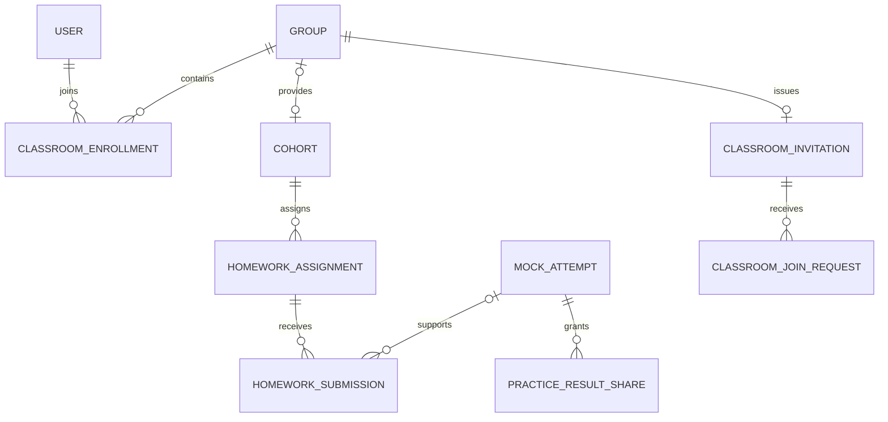

# BESTWAY 5.0 database audit

Prisma owns the legacy `User`, `StudentProfile`, `Group`, attendance, payments, points, and exam records. Django owns enrollment history, cohorts, classroom assignments, homework submissions, and the new invitation and practice-sharing records.

Before 5.0, the group API overwrote `StudentProfile.groupId` and closed the student's only open history row. The invite endpoint searched `Cohort.invite_code` and rejected a cohort linked to a classroom. An invitation redeemed in a standalone cohort only created a `CohortMembership`. It did not put the learner on a classroom roster.

Migration `0029` replaces the single open period per student with one per student and group. It backfills a valid legacy primary group when the student has no open history. Its start date stays unknown. A conflict with existing open history stays available for review. `0030` adds revocable practice grants. Migrations leave existing assignments, results, payments, and attendance in place.

Run `python manage.py report_classroom_reconciliation` in an authorized administrative environment. It lists mismatched records and standalone cohorts for review. Treat the identifiers as restricted and resolve each conflict from enrollment records. Reversing to the old unique constraint would fail when multiple active memberships exist. Preserve the migrated data and prepare a forward fix if a rollback is needed.

## Safe Account Reconciliation & Recovery

`AccountReconciliationLog` (`core.0031`) records an immutable pre-merge snapshot (`snapshot_before`) and `transferred_summary` whenever an administrator merges two accounts via `/v1/users/reconciliation/*`.

- **Identity verification**: Accounts are discovered only by matching normalized phone, email, or linked Telegram chat ID—never by name similarity alone. Unverified pairs require explicit administrator ownership attestation.
- **Conflict blocking**: Conflicting payment months (`state` or `amount` mismatch), conflicting attendance dates (`state` mismatch), or two distinct linked Telegram accounts block the merge automatically.
- **Recovery**: Because the source `User` row is deactivated (`is_active=False`) rather than deleted and `snapshot_before` stores the original records, an administrator can inspect `AccountReconciliationLog` and `AuditLog` (`account.reconcile_merge`) to trace or reverse transferred identifiers if ever needed.
